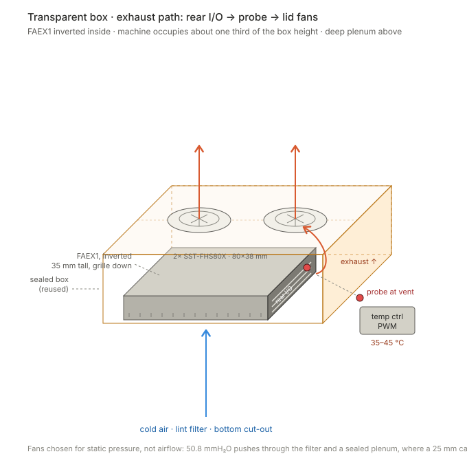
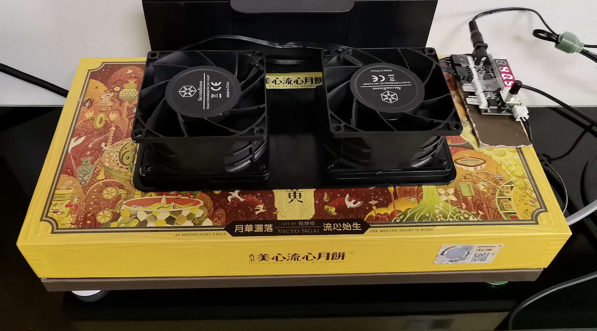

# AI-MAX-395 — Running 125B MoE on 128 GB unified memory

Hands-on deployment notes from a single AMD Ryzen AI Max+ 395 machine.
Not a tutorial — a record of what was measured, what broke, and what the
benchmarks got wrong.

**Results at a glance**

- **125B MoE (Q6_K_XL) on 128 GB unified memory**: 34.9–36.9 t/s median
  generation, 169 GB resident, 262K context, 10 h 44 m continuous with zero
  restarts, −4~6 % degradation at 224K+.
- **Two-model setup**: a 125B MoE for long context, a 27B Q8 for coding at
  13.6 t/s. One model at a time — concurrency on this box is a bandwidth
  problem, not a scheduling one.
- **Video (MiniMax H3)**: VRAM peak is flat at 52.2–53.3 GiB across a 2.25×
  pixel-area range; wall time grows superlinearly.
- **Thermals**: 25 days of continuous operation, 14,104 full-load samples,
  **zero hard-throttle events**. Edge temperature is decided by the power tier,
  not the cooling: 160 W peaks at 94 °C, 120 W peaks at 88 °C with zero samples
  above 90 °C.

---

## Hardware

| | |
|---|---|
| SoC | AMD Ryzen AI Max+ 395 (Strix Halo) |
| Memory | 128 GB LPDDR5X unified, ~124 GB usable as GTT |
| iGPU | Radeon 8060S |
| Backend | ROCm / HIP, target `gfx1151` |
| OS | Ubuntu, kernel with `amdgpu` GTT exposed |

The point of this machine is that CPU and GPU share one pool. A 125B MoE
model at Q6_K_XL is ~169 GB on disk; it runs because weights stream from
NVMe into the same memory the iGPU reads from — no PCIe copy, no discrete
VRAM ceiling.

That is also its limit.

## The core constraint: one model at a time

Unified memory is a shared-bandwidth pool, not two pools that happen to be
close. Once a 125B MoE is resident, memory bandwidth is saturated. Running a
second model "concurrently" does not overlap — it time-slices, and both get
slower.

**So concurrency is not a scheduling problem on this box. It is a bandwidth
problem.** Scaling means more machines, each running one model — not a bigger
machine running several. Both LLM backends also bind port 8080 by default,
which enforces the same conclusion at the OS level: only one can be up.

## Three backends, mutually exclusive

| Backend | Model | Role |
|---|---|---|
| **Strata** v0.2.11 | Qwen3.8-Flash-Next UD-Q6_K_XL — 125B MoE, 169 GB, 262K ctx | long-context work |
| **llama.cpp** v0.9.0 | Qwen3.8-27B UD-Q8_K_XL + MTP Q4 draft | coding default |
| **ComfyUI** | MiniMax H3 — FastH3 v2 (8-step distill) / Ref2VA (20-step) | video generation |

Switching backends means changing which unit auto-starts, then rebooting:
**~2 min 50 s per switch**, and any in-flight session dies. So the machine is
configured for one primary mode, and the other two are scheduled windows.

## What I measured

### LLM throughput

| Backend | Model | Median TG | Notes |
|---|---|---|---|
| Strata | Flash-Next 125B MoE Q6 | **34.9–36.9 t/s** | −4~6 % degradation at 224K+ context; 10 h 44 m uptime, zero restarts |
| llama.cpp | Qwen3.8-27B Q8 + MTP | **13.6 t/s** | On >100K-token sessions, actual prefill median is only **592 tokens** |

The 27B number looks low until you look at the second column: most agentic
coding turns only prefill a few hundred new tokens because the prompt cache
carries the rest. **Throughput per second is the wrong metric for agentic use —
tokens-per-turn-latency is.**

### Video generation (MiniMax H3, 124 frames, 8 steps)

| Resolution | Wall time | VRAM peak |
|---|---|---|
| 576 × 1024 | 436.5 s | 52.24 GiB |
| 768 × 1344 | 933.4 s | 53.27 GiB |
| 864 × 1536 | 1441.5 s | 52.60 GiB |

**VRAM is essentially flat (52.2–53.3 GiB) across a 2.25× pixel-area range.
Wall time is superlinear.** The practical consequence: when you need better
quality, raise resolution and accept the time cost — do not ration VRAM,
because it is not the binding constraint. All three outputs verified with
`ffprobe`: 124 frames, 5.167 s, h264+aac, zero decode errors.

## What I got wrong

Draft-model / speculative decoding, three candidates, measured across context
bands rather than at one point:

| Candidate | Bench result | Production A/B |
|---|---|---|
| DFlash2 | **+47 %** | **Reversed** — rolled back |
| DSPARK | negative | negative at every context length |
| MTP Q4 sidecar | modest gain | **only option non-negative across all bands** |

The lesson cost two weeks: **a single-point benchmark told me the opposite of
the truth.** Any draft-model proposal now has to report results at 32K / 64K /
96K separately — one number is not evidence.

## Memory

- Strata leaves `MemAvailable` pinned at **~0.4 GiB** while running. This is a
  designed steady state (resident budget + expert cache are sized to consume
  almost everything), **not a leak**. It does mean no other process may allocate
  meaningfully during an LLM session.
- Key flags that produce that state: `--resident-budget-gib 43`,
  `--expert-cache 13000`, `--mmap-experts`, `--vram-reserve-mib 700`.

## Thermals: recirculation, not dissipation

Sustained load pushes the edge temperature to **~94 °C** on the highest power
tier. The SoC downclocks a few percent rather than hitting the hard throttling
floor — the clock never fell below it across 14,104 full-load samples over 25
days.

But dissipation was never the bottleneck. The rear I/O panel is the exhaust;
on a desk, that hot air curls back into the top intake about thirty centimetres
above it. **The machine ends up heating its own supply air.**

*Schematic — the plenum, the single intake path, and where the probe sits.*

*The actual build. Enclosure is a reused mooncake gift box; two 80 mm fans bolted through the lid; the controller is taped to the right side and reads 33 °C — below the 35 °C ramp start.*

### The fix, and the one number that matters

Do not touch the internal airflow — change only the boundary conditions. One
intake path, one exhaust path, **and the box sealed so there is no third
opening**:

1. **One intake path.** Invert the machine so the stock intake grille faces
   down, and press it flat against a filtered cut-out in the bottom of a box.
2. **Capture the exhaust.** The box becomes a plenum: the rear panel vents into
   it, and two fans on the lid pull that air out before it can come back.

The box adds no cooling capacity. It only stops the machine from breathing its
own exhaust.

A filter plus a sealed box is a **high-impedance system**. A normal 25 mm case
fan moves 2–3 mmH₂O of static pressure; behind a lint sheet it stalls to nearly
nothing — it spins, and no air moves. The fans used here push **50.8 mmH₂O**,
roughly twenty times more. **Airflow rating is irrelevant here; static pressure
is the only number that matters.**

| Item | What | Why this one |
|---|---|---|
| Enclosure | Reused mooncake gift box, ~1.5 L | Free, the right size, and stiff enough that the fans don't sag the lid |
| Filter | Washing-machine lint sheet | Catches dust without choking airflow |
| Fans | 2× SilverStone **SST-FHS80X** | 80 × 38 mm, **50.8 mmH₂O** static, 83.7 CFM, PWM 2k–10k RPM |
| Control | PWM temperature controller, probe taped at the rear vent | Tracks exhaust temperature, not a lagging die sensor |
| Setpoint | 35–45 °C ramp | Quiet at idle, full speed well before throttling |

### Results

**Twenty-five days of continuous operation, 14,104 full-load samples, zero
hard-throttle events** — and the fans stayed at the low end of their ramp,
because the intake air never gets hot.

**Power tiers decide the tail, not the median.** The box has two tiers, set in
firmware: **160 W and 120 W**.

| PPT tier | Samples | Median edge temp | p90 | Peak | Samples ≥ 90 °C |
|---|---|---|---|---|---|
| 120–130 W | 3,921 | 79.0 °C | 82 °C | **88 °C** | **0** |
| 140–150 W | 4,150 | 79.0 °C | 82 °C | 91 °C | 7 |
| 150–160 W | 4,104 | 79.0 °C | 87 °C | **94 °C** | **160** |

Median temperature is identical across all three tiers. What the lower tier
buys is the **tail**: p90 drops by 5 °C, peak by 6 °C, and the ≥ 90 °C samples
go to zero. Dropping the tier does not make the machine cooler on average — it
makes the worst case stop happening.

**And the enclosure is what makes that possible.** Over a five-day stretch with
no cooling rig at all, ambient was about 10 °C lower than usual — and the
full-load temperature was **not lower at all**, sitting in the same 76–82 °C
band. Cooler ambient should have helped. It did not, because the limiting
factor was never the room temperature but the air path itself: without the
sealed plenum, the machine keeps re-breathing its own exhaust. **A 10 °C cooler
room is worth nothing if the box still inhales its own tail.**

*(Temperatures are `edge` readings from the SoC die, sampled once a minute.
The `power` column in the logs is package power — whole-APU, not the GPU core
— so tiers have to be compared within the same power band.)*

## Setup notes

- ROCm built from source for `gfx1151`; stock packages did not cover this target
  at the time. A tuned `hipBLASLt` table made a measurable difference and is
  worth generating per-machine.
- Each backend runs as its own systemd unit; a small switch script flips the
  auto-start target, reboots, then polls until the service port is actually
  serving (machine-up ≠ service-ready — the 125B model takes minutes to load).
- Video generation and LLM work are gated by an atomic lock file, so a submit
  from one never lands while the other holds the GPU.

## Open questions

- Expert-cache hit rate is the dominant variable for 125B MoE throughput on this
  box. What is the actual curve vs. cache size? I have one data point, not a curve.
- Can speculative decoding stay work-neutral at 224K+ context, or does the draft
  model's own KV cost eat the gain?
- Is there a defensible way to share the pool between a small always-on model and
  a large on-demand one, or is "one model per machine" the only sane topology?

## Status

Personal research setup. Numbers above are from this specific unit, this ROCm
build, these model quants. Treat them as a data point, not a benchmark suite.
